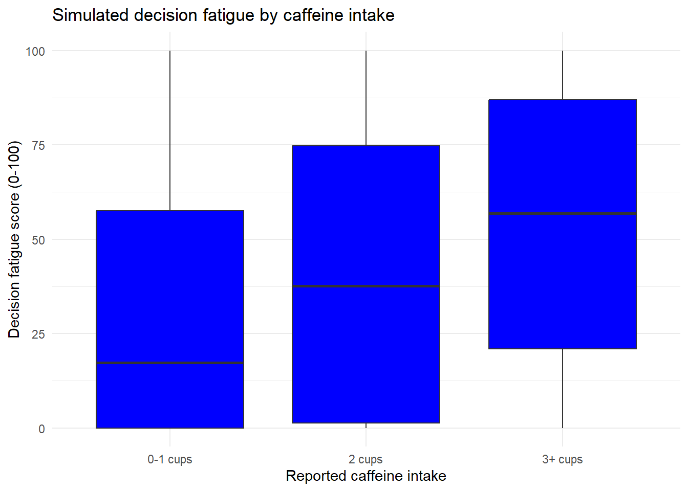

# Caffeine Intake and Decision Fatigue

An R analysis of 25,000 synthetic behavioral records, examining differences in decision fatigue across caffeine intake groups and modeling its associations with caffeine intake and sleep duration.

**Author:** Kadin Kolstad | [Portfolio](https://kadinkolstad.com)

## Questions

- How do fatigue scores differ between records reporting 0-1 cups and 3+ cups of caffeine?
- How does sleep duration relate to fatigue after controlling for caffeine intake?
- What do regression diagnostics reveal about the limitations of a two-predictor linear model?

## Key findings

| Measure | Result |
| --- | ---: |
| Mean fatigue score, 0-1 cup group | 31.14 |
| Mean fatigue score, 3+ cup group | 53.45 |
| Mean difference, higher intake minus lower intake | 22.31 points |
| Welch 95% confidence interval for the mean difference | 21.28 to 23.35 points |
| Partial correlation of sleep and fatigue, controlling for caffeine | -0.507 |
| Caffeine coefficient, holding sleep constant | +5.26 points per cup |
| Sleep coefficient, holding caffeine constant | -16.20 points per hour |
| Two-predictor model R-squared | 0.314 |



The boxplot shows medians and spread within each group; the table reports group means. Fatigue scores overlap substantially across intake groups. All results describe the supplied synthetic dataset and do not establish effects in real people.

## Data source

The [Human Decision Fatigue Behavioral Dataset](https://www.kaggle.com/datasets/sonalshinde123/human-decision-fatigue-behavioral-dataset) was published on Kaggle by Sonal Shinde (`sonalshinde123`). Each row represents a simulated decision-making state. The fatigue score was constructed from other variables during data generation.

- Dataset: 25,000 records and 13 original variables.
- Missing values: none in the supplied CSV.
- Exact duplicate rows: one, retained because it could not be established as an erroneous record.
- Caffeine intake groups: 0-1 cups (11,144 records), 2 cups (6,382), and 3+ cups (7,474).
- Dataset version: 1; source metadata checked October 14, 2026.
- **Dataset license:** [CC0 Public Domain](https://creativecommons.org/publicdomain/zero/1.0/). This describes the dataset's license.

The dataset creator is credited for the data; the R analysis and interpretation are my work.

## Methods and tools

The report includes data checks, grouped summaries, exploratory visualization, Pearson and partial correlations, a Welch two-sample t-test, multiple linear regression with caffeine and sleep as predictors, standardized coefficients, and model diagnostics.

Analysis packages: tidyverse, corrgram, ppcor, and lm.beta. The report is written in R Markdown and rendered with rmarkdown and knitr.

## Model limitations

The regression explains approximately 31.4% of the in-sample variation in fatigue scores, with a residual standard error of approximately 30.4 points. Diagnostics show changing residual variance and departures from normality. Some fitted scores fall outside the possible 0-100 range, so the model is treated as an exploratory baseline. Conventional regression confidence intervals and significance tests require caution given the observed unequal residual variance.

These are simulated records, not measurements from human participants. Associations may reflect the data-generation rules. The analysis does not validate causal claims or predictions for real people, and it does not include a held-out prediction evaluation.

## Run the report

1. Download the repository with **Code > Download ZIP**, then extract it.
2. Use R 4.1 or newer; RStudio is recommended. Keep the CSV and R Markdown file in the same folder.
3. Install the required packages once in the R console:

```r
install.packages(c(
  "rmarkdown", "knitr", "tidyverse",
  "corrgram", "ppcor", "lm.beta"
))
```

4. Open `caffeine_decision_fatigue.Rmd` in RStudio and select **Knit > Knit to HTML**.

To read the already rendered report, open `caffeine_decision_fatigue.html` in a browser after downloading it. GitHub's ordinary file view shows HTML source; downloading the repository gives you the report you can open locally.

## Files

| File | Purpose |
| --- | --- |
| `caffeine_decision_fatigue.Rmd` | Analysis source and narrative |
| `caffeine_decision_fatigue.html` | Rendered report with results and embedded plots |
| `human_decision_fatigue_dataset.csv` | Original synthetic dataset |
| `fatigue_by_caffeine.png` | Figure displayed in this README |
| `README.md` | Project overview and reproduction instructions |
| `.gitignore` | Excludes local R session and operating-system files |
